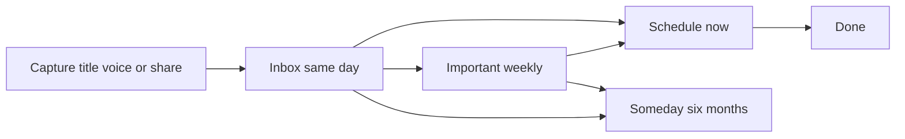

# Sorted Product Requirements Document

Version 2.0 · 25 November 2026 · Status: client-aligned, React Native Android V1

**Authoritative client source:** `Sorted — Business Requirements Document v1.3.docx` (8 November 2026, @Mobasser).

**This document clarifies:** production V1 is a **dedicated offline Android app**. Optional **AI-assisted capture** is a separately labeled product extension requested after the BRD; it does not replace client-mandated Inbox-first capture, native reminders, or device integrations.

---

## 1. Product purpose and promise

Sorted gives a professional **one trusted place for everything on their mind**, so the anxiety of holding it all can disappear. It does **not** promise that every task gets done.

**Target user:** balances many work and personal tasks; tasks arrive from conversations, messages, and meetings and get lost in one undifferentiated list.

**Design principles (client BRD)**

- Calm, positive, low-anxiety tone; pastel blue direction.
- No guilt mechanics: no streak loss, no red overdue counters, no shaming copy.
- Nothing is silently overdue or forgotten—every task is placed, rescheduled, or reviewed.
- Clear **“You’re sorted”** state when the user has processed everything that needs a decision.
- Reminders are gentle in tone and costly to skip by accident (with return via notification or evening summary).

---

## 2. Platform and delivery

| Attribute | Requirement |
| --- | --- |
| Production V1 | **React Native** Android application (installable APK/AAB) |
| Minimum OS | Android 8.0 (API 26) |
| Users / devices | One user, one device; no accounts |
| Data | Local database only; offline-first for all **client V1** features |
| iOS / web product | **Out of scope** for V1 |
| Distribution | Play Store or direct install—**open decision (BRD #7)** |

**Implementation stack (target, not yet scaffolded in repo)**

- React Native + TypeScript
- SQLite local persistence (e.g. WatermelonDB or equivalent)
- Android native modules: exact alarms, reboot rescheduling, notification actions, share intent, speech recognition, calendar provider
- Optional Notification Listener (Kotlin, **off by default**)
- Optional AI: HTTPS backend only; **no provider keys in the app bundle**

Primary navigation: **Home, Inbox, Projects, Review, Settings.** Quick capture is the most prominent control on Home.

---

## 3. How work flows (client model)

1. **Capture fast** — title only into **Inbox** (under 15 seconds from opening the app).
2. **Sort later** — assign category, split messages, run readiness for Schedule now.
3. **Act or reconsider** — complete, reschedule with reason, or recategorise; missed slots surface gently.
4. **Review** — weekly Important session; periodic Someday batch.
5. **Protect data** — manual export; no automatic cloud backup in V1.

---

## 4. Client V1 requirements (must ship)

These come from BRD sections 2–9. Missing any of them means V1 is incomplete.

### 4.1 Onboarding and rhythm (FR-01)

| Acceptance |
| --- |
| Required: weekend review day (Friday, Saturday, or Sunday) and usual working hours. |
| Quiet hours configured; special-day overrides supported. |
| Notification permission explained in context before request. |
| Notification Listener optional; declining it leaves all other features usable. |
| Privacy explanation for any optional listener access; off by default. |

### 4.2 Capture — client path (FR-02)

| Acceptance |
| --- |
| Typed capture needs **only a title**; no category at capture; lands in **Inbox**. |
| Saving capture completes in **under 15 seconds** from app open. |
| Capture UI opens in **under 1 second** on a mid-range device. |
| **Voice-to-text** via device speech recognition into Inbox with original text kept. |
| **Share-to-app** from other apps (e.g. messaging, email) into Inbox with original text and source app name. |
| Quick capture is the most prominent Home control. |

### 4.3 Inbox sorting and tasks (FR-03, FR-05)

| Acceptance |
| --- |
| States: Inbox, Schedule now, Important, Someday, Done. |
| One message can **split** into several tasks; each keeps original text when context is retained. |
| Create, edit, complete, **soft-delete**, recategorise. |
| Link **one Project** and **one Meeting** per task. |
| Original text and capture source remain visible. |
| State-change history with timestamps. |
| Inbox cleared same day; empty Inbox shows **“You’re sorted”**. |

### 4.4 Schedule now readiness (FR-04)

| Acceptance |
| --- |
| Schedule now requires: **start date/time**, **duration**, **energy level** (High / Medium / Low focus)—confirm with owner (BRD open #11). |
| Optional prerequisite note; never blocks scheduling. |
| If user cannot pass gate, app offers **Important**. |
| Missed slot without completion surfaces on next open or evening summary; cannot stay silently overdue. |
| Reschedule logs prior/new slot and reason. |

### 4.5 Projects and meetings (FR-07, FR-08)

| Acceptance |
| --- |
| Project: name, optional description and target date, context (Work / Family / Personal), Active / Archived; progress = completed / total tasks. |
| Meeting: title, date/time, notes, free-text participants, optional Project. |
| Meetings may exist without a Project; task linked to Meeting inherits Meeting’s Project when present. |
| Archive vs delete semantics: **open (BRD #4)**—do not ship a silent choice without owner approval. |

### 4.6 Home (FR-09)

| Acceptance |
| --- |
| Today’s Schedule-now tasks, Inbox count, items needing attention, next meeting or scheduled item, quick capture. |
| No red overdue counters or shaming wording. |

### 4.7 Device calendar (FR-10)

| Acceptance |
| --- |
| Create device calendar event from Schedule-now task (start + duration); store **calendar event ID** on the task. |
| Which calendar and deleted-event behavior: **open (BRD #5)**. |

### 4.8 Native reminders (FR-11 — core, not polish)

| Acceptance |
| --- |
| Schedule now: prompt at slot start; prompt to add calendar on the day task is scheduled. |
| Inbox: **at least three reminders per day** until cleared; skip requires deliberate multi-step confirm + return time. |
| Weekly review on chosen weekend day; skipped session offered next day and in evening summary. |
| Someday batch ~every six months (exact interval: **open #6**). |
| Evening summary: done, waiting, needs reschedule. |
| Quiet channel; actions: Done, Reschedule, Snooze with reason, Move category. |
| Respect quiet hours (all) and working hours (work-related); snooze reason stored and visible in weekly review. |
| Survive **reboot**, **Doze**, manufacturer battery restrictions; first-run permission checklist. |
| Verified on **at least three Android device brands** with results recorded. |
| **In-app “needs attention” lists alone do not satisfy this requirement.** |

### 4.9 Reviews (FR-12, FR-13)

| Acceptance |
| --- |
| Weekly: max **15 minutes**; Important grouped by Project; promote to Schedule now (runs gate), keep, Someday, delete; pause/resume; first **3** sessions unlimited, then **20** items per week—which 20 is **open (#3)**. |
| Someday: grouped batch; promote, keep, delete; user can postpone part of batch. |
| Ends with “You’re sorted” when appropriate. |

### 4.10 Export and offline (FR-14)

| Acceptance |
| --- |
| JSON export: all Task, Project, Meeting, settings, history; CSV export: tasks. |
| Works in airplane mode. Import not required in V1. |
| App reminds user to export periodically; states no automatic backup. |
| No telemetry or cloud analytics in V1. |

### 4.11 Energy guidance (FR-15)

| Acceptance |
| --- |
| In-app guidance on building/protecting energy for demanding tasks, linked from energy field. |

### 4.12 Accessibility and performance (NFR)

| Acceptance |
| --- |
| Screen-reader labels, readable sizes, sufficient contrast on pastel palette. |
| Time zone and DST changes do not shift reminders unexpectedly (strategy to be defined and device-tested). |

---

## 5. Requested extras — AI capture (V1+, not in original BRD)

Document and build **after** client V1 foundations and native reminders. Label clearly in UI and docs.

| ID | Requirement | Acceptance |
| --- | --- | --- |
| EX-01 | Optional capture modes | **Default** remains client Inbox capture. Optional **Manual** (full form) and **AI** (message → proposals) as secondary entry points. |
| EX-02 | AI proposals | Extract independent actions; propose type, priority, date/time, duration, focus; show uncertainty (AM/PM, conflicts, past dates). |
| EX-03 | Confirmation | Nothing saved to the local plan until user confirms; discard leaves saved tasks unchanged. |
| EX-04 | Context | User setting for original-message retention on new AI-derived tasks; editable/removable per task. |
| EX-05 | Backend | Hosted model (e.g. Gemini) via server; rate/size limits; schema validation in app code; keys only on server. |
| EX-06 | Offline fallback | Manual capture and full local task management work without network; AI path fails gracefully. |

The Vite prototype’s local English parser and Gemini loopback backend are **reference implementations only** for UX and contract testing (`src/organize.js`, `server/`).

---

## 6. Explicitly out of scope for V1

Per client BRD: accounts, cloud sync/backup, collaboration, continuous listening, meeting transcription, **production website**, iOS, external integrations, advanced analytics, recurring tasks, attachments, search, mental-load check-in.

BRD listed **advanced AI/NLU** as out of V1; **EX-*** above is an agreed add-on, not a reinterpretation of the signed BRD scope for client delivery.

**Future (appendix only):** V2 intelligence, V3 sync/sharing, V4 teams and company platform—do not implement in V1.

---

## 7. Data model (minimum)

All records: **UUID**, `createdAt`, `updatedAt`, **soft-delete** flag.

| Entity | Key fields |
| --- | --- |
| Task | title, state, original text, capture source/app, optional Project/Meeting, completion time, state history |
| Schedule now | start, duration, energy, optional prerequisite note, optional calendar event ID |
| Project | name, description, target date, context, Active/Archived |
| Meeting | title, date/time, notes, participants, optional Project |
| Reschedule/snooze | task id, slots, reason, timestamp |
| Settings | weekend day, working/quiet hours, permissions flags, review progress |

---

## 8. Open decisions (resolve with product owner)

| # | Question | Blocker for |
| --- | --- | --- |
| 1 | Repeated-reschedule nudge threshold | History UX |
| 2 | Reminder escalation ceiling | Notification tone |
| **3** | Which 20 Important tasks in capped weekly review | **Review screen** |
| **4** | Project archive vs delete | **Data integrity** |
| **5** | Default calendar; deleted events | **Calendar sync** |
| 6 | Exact Someday interval / configurable | Someday scheduling |
| **7** | Target SDK; Play vs sideload | **Release** |
| 8 | App and voice languages | Localization |
| 9 | Qualitative “less anxiety” validation | Research |
| 10 | Notification Listener depth and apps | Privacy scope |
| **11** | Per-task energy label vs guidance only | **Readiness gate** |

Items **3, 4, 5, 7, 11** should be closed before production release.

**Prototype defaults (demo only, not production policy):** per-task energy; oldest-first review cap grouped by Project; no reschedule nudge.

---

## 9. Vite React prototype (not the product)

The repository includes a **browser prototype** (`src/`, Vite, optional Node AI server) and optional GitHub Pages demo. Purpose:

- Clickable UX spec: navigation, copy tone, task states, review flows
- Logic reference: `src/model.js` (lifecycle, exports), `src/organize.js` (scheduling checks)

**Not acceptable as V1 delivery:** `localStorage` persistence, phone-frame CSS, in-app attention filters without native notifications, presenting Pages as the client app.

---

## 10. Recommended build order

1. Close open decisions **3, 4, 5, 7, 11** with client.
2. **React Native foundation:** DB, onboarding, Inbox capture, task CRUD, navigation, export.
3. **Device capture:** share intent, speech, source metadata.
4. **Native reminders + calendar + reboot/Doze** (acceptance on three brands).
5. Reviews (weekly + Someday).
6. Optional Notification Listener.
7. **AI extras (section 5)** last.
8. Full BRD section 9 acceptance + accessibility pass.

Do not expand the web prototype as if it were the shippable product; port behavior and UX intent into the native app.

---

## 11. Release acceptance (client BRD section 9)

V1 is accepted when **all** behaviors below pass on **at least three device brands**:

| Area | Criterion |
| --- | --- |
| Capture | Typed or voice to Inbox in under 15s from open; shared text intact |
| Split | One message → several tasks with original text preserved |
| Readiness | No Schedule now without start, duration, energy |
| Missed task | Past slot surfaced; never silently overdue |
| Inbox reminders | ≥3 per day while Inbox non-empty; skip is multi-step |
| Weekly review | Chosen day; ≤15 min; 3 unlimited then 20 cap |
| Someday | ~6-month grouped batch |
| Reminder reliability | Survives reboot and Doze on test devices |
| Calendar | Event with correct start/duration; ID stored |
| Offline + export | Core features in airplane mode; complete export file |
| Calm tone | No red overdue counters or shaming copy (design checklist) |

**Success proxies (local only):** same-day Inbox clearing, reviews completed in ≤15 minutes, Schedule-now tasks completed or consciously rescheduled.

---

## 12. Document history

| Version | Date | Change |
| --- | --- | --- |
| 1.3 | 8 Nov 2026 | Client BRD (docx) |
| 1.4 | 15 Nov 2026 | Prototype-oriented PRD; AI-first drift |
| 2.0 | 25 Nov 2026 | Realigned to client Android V1; React Native platform; AI as labeled extra; prototype demoted |